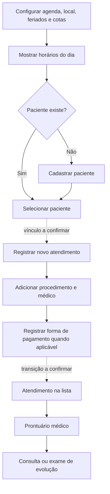
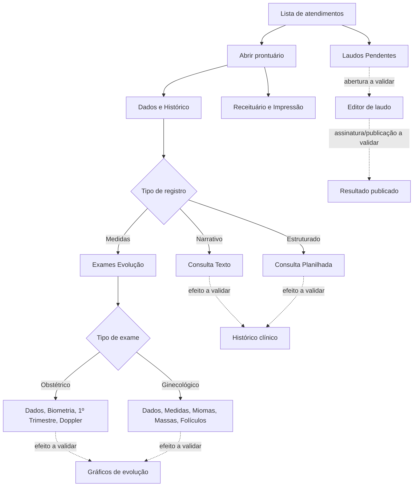
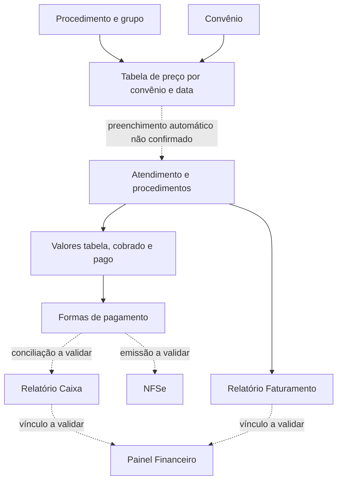

# DEV-004 — Mapa funcional, jornadas e lacunas por perfil

**Projeto:** Projeto Piloto · **Competência do levantamento:** 05/11/2026 · **Estado:** documentação de arquitetura funcional; nenhum comportamento clínico ou financeiro homologado.

## 1. Objetivo e regras de evidência

Este documento transforma o inventário do WebUltra em **requisitos de um produto próprio**, sem copiar código, identidade visual exclusiva, imagens ou dados do fornecedor. É uma referência para UX, banco de dados, APIs, testes e a futura DEV-005.

**Legenda obrigatória:**
- **O — Observado:** campo, aba, botão, lista ou navegação aparece na captura ou no inventário técnico.
- **D — Documentado:** comportamento descrito nos manuais; não foi reproduzido na coleta atual.
- **I — Inferido/proposto:** relação lógica desejada para o novo produto, ainda **não validada** no WebUltra.
- **P — Pendente:** evidência ou teste ausente.
- **T — Testado:** ação executada e comprovada com dados de teste. **Nenhuma** das integrações descritas abaixo possui esta classificação no levantamento.
- **H — Homologado:** aprovado por responsável da clínica. **Nenhuma** das jornadas aqui descritas foi homologada.

Os códigos `ADM-XX` e `MED-XX` referem-se a [DEV-002_MATRIZ_VISUAL.md](DEV-002_MATRIZ_VISUAL.md), com as imagens originais guardadas **somente no Drive**.

## 2. Inventário completo de navegação — perfil administrativo

| Seção / menu proposto para o Projeto Piloto | Telas cobertas | Função documentada | Alcance da evidência |
|---|---|---|---|
| Agendamento | ADM-01, ADM-02, ADM-03, ADM-04, ADM-05, ADM-06 | Grade por dia/agenda, agenda regular, exceções, feriados, locais e cotas | O/D: telas e controles; P: regras de bloqueio e persistência |
| Relatórios | ADM-07, ADM-08, ADM-09, ADM-10, ADM-11, ADM-12 | Analítico detalhado, resumo, faturamento, caixa, detalhado caixa, solicitantes | O: filtros; P: resultados e cálculos |
| Atendimentos | ADM-13, ADM-14 | Lista, filtros, novo atendimento, procedimentos, pagamentos e atalhos | O: interface; P: ações, alteração, exclusão e vinculação |
| Pacientes | ADM-15, ADM-16 | Lista/pesquisa e cadastro/contatos/convênio/DICOM | O: interface; P: validações e armazenamento |
| Médicos | ADM-17, ADM-18 | Lista/cadastro, conselho, especialidade, certificado e assinatura | O: interface; P: upload, validade e assinatura |
| Catálogo | ADM-19, ADM-20, ADM-38 | Procedimentos, grupos, formulário de procedimento, códigos, preparo, termo | O/D: lista e campos; P: imagem ADM-38 e efeitos de cadastro |
| Preços | ADM-21 | Relação procedimento × convênio × data de referência × valor | O: controles; P: regra de vigência e aplicação automática |
| Convênios | ADM-22, ADM-23 | Lista e cadastro de convênio, tabela, ativo, pagamento e coparticipação | O/D: campos e lista; P: imagem ADM-23 e regras |
| Usuários e perfis | ADM-24, ADM-25 | Conta, ativo, vínculo médico, perfil e lista de perfis | O: atributos; P: matriz de permissões |
| Formas de pagamento | ADM-26, ADM-27 | Lista, cadastro e indicador de NFSe | O: controles; P: emissão efetiva |
| Textos e laudos padrão | ADM-28, ADM-29, ADM-30 | Frases padrão, modelos normais, substituições textuais | O: editor e listas; P: renderização, persistência e substituição |
| Documentos e termos | ADM-31, ADM-39 | Lista de consentimentos e formulário com editor | O/D: editor e marcadores; P: geração e assinatura |
| Financeiro | ADM-32, ADM-33, ADM-34, ADM-35 | Categorias, despesas recorrentes, receitas/despesas do mês | O: lista e filtros; P: conciliação, recorrência e ligação com caixa |
| Institucional/configuração | ADM-36, ADM-37 | Termos de uso e aba Cabeçalho: logo, impressão, fonte, margens | O: aba Cabeçalho; P: demais abas e efeitos da configuração |

**Navegação adicional visível, mas sem tela funcional confirmada:** painéis de chamada 1/2, Gráficos Agendamento (inventário 40), Dashboard Agendamentos (41), Gerar Link (42). Não atribuir permissões nem criar telas como se tais funções tivessem sido testadas.

## 3. Inventário completo — perfil médico

| Grupo de trabalho clínico | Tópicos | Funções registradas | Limite |
|---|---|---|---|
| Entrada e prontuário | MED-01, MED-02, MED-03 | Atendimento, Dados e Histórico, Exames Evolução | Acesso ao prontuário descrito; salvamento não executado |
| Obstetrícia | MED-04, MED-05, MED-06, MED-07 | Dados gestacionais, biometria, 1º trimestre, Doppler | Doppler sem captura própria; fórmulas não validadas |
| Ginecologia | MED-08, MED-09, MED-10, MED-11, MED-12 | Dados, medidas, miomas, massas anexiais, folículos | Campos vistos; unidades/fórmulas e inclusão de itens não testadas |
| Visualização de séries | MED-13 | Gráficos e análises de medidas | Gráficos observados, resultados não validados |
| Evolução em consulta | MED-14, MED-15 | Texto livre, histórico, texto padrão; planilha com Queixa/HDA | Duas modalidades distintas; gravação não executada |
| Prescrições | MED-16 | Modelos, alertas, editor e gerar prescrição | Não houve emissão, assinatura ou envio |
| Arquivos e impressão | MED-17, MED-18 | Upload, atestados, imprimir, PDF e assinatura | Nenhum arquivo inserido, documento gerado ou assinado |
| Calculadoras | MED-19 | IOTA, fratura, cardiovascular, Kupperman, idade gestacional, IMC | Só seleção de ferramentas; não usar cálculo clínico sem validação |
| Laudos pendentes | MED-20 | Filtros por período/médico, fila e atalho para editor | Fila vista; editor e publicação **não verificados** |
| Interfaces de apoio | MED-21, MED-22, MED-23, MED-24, MED-25, MED-26 | Agenda, pacientes, relatórios, médicos, configurações e questionários | Menu apresentado ≠ acesso autorizado; MED-23/26 sem imagem |

**Atenção aos nomes herdados dos JPG:** MED-05, 06, 08, 09, 10, 11, 12, 18, 22 e 25 têm nomes que sugerem assuntos diferentes da tela mostrada. Consultar a matriz DEV-002; não usar o nome do JPG para decidir qual componente construir.

## 4. Jornada da recepção — agendamento até prontuário

| Etapa | Interface / entidades candidatas | Estado e dependência |
|---|---|---|
| Definir disponibilidade | ADM-02 a ADM-06: `agenda`, `agenda_excecao`, `feriado`, `local`, `cota` | O: telas; I: modelo de dados; P: regras de conflito/cota |
| Consultar agenda | ADM-01, MED-21: `horario`, `agendamento` | O: colunas; P: como horário é reservado ou cancelado |
| Selecionar/cadastrar pessoa | ADM-15/16, MED-22: `paciente` | O: dados cadastrais e busca |
| Abrir atendimento | ADM-14: `atendimento`, `atendimento_procedimento` | O: formulário e Adicionar; P: salvamento e origem da agenda |
| Listar e acompanhar | ADM-13, MED-01: `status_atendimento` | O: tabela; P: transições de status |
| Abrir prontuário | MED-01→MED-02 | D: atalho Abrir Prontuário; P: permissões e histórico |
| Registrar consulta | MED-14/15 | O: editores; P: persistência, edição e versões |

**Não comprovado:** que marcar horário crie atendimento automaticamente; que o pagamento seja obrigatório para iniciar prontuário; que toda evolução altere automaticamente status de atendimento.

## 5. Jornada clínica — consulta, exames e laudo

**Observado/documentado:** MED-14 e MED-15 são editores distintos; MED-03 oferece dados obstétricos/ginecológicos; MED-16 e MED-18 exibem comandos de gerar documentos; MED-20 apresenta fila e atalho para laudo.

**Não testado:** persistência da consulta, cálculos de biometria, gráficos e Doppler, emissão de prescrição, integração com certificado, autorização de publicação, envio por WhatsApp, histórico de alterações. Recursos de IA foram vistos, **não ativados**.

## 6. Jornada de cobrança, faturamento e financeiro

| Dependência | IDs | Dados indicados na interface | Qual verificação falta |
|---|---|---|---|
| Grupo → Procedimento | ADM-20 → ADM-38/19 | Nome do grupo, nome/códigos/tipo do procedimento | Gravação, alteração e obrigatoriedade de termo |
| Convênio + procedimento + data → preço | ADM-22/23 + ADM-19/38 → ADM-21 | Convênio, procedimento, data de referência, valor | Vigência do preço e regra de fallback |
| Preço → procedimento no atendimento | ADM-21 → ADM-14 | Valor Tabela, Valor Cobrado | **Preenchimento automático já relatado como problema, sem reteste** |
| Atendimento → parcelas/pagamento | ADM-14 → ADM-13 | Forma de pagamento, valor pago, valor cobrado | Pagamentos parciais, estorno, conciliação |
| Pagamento → caixa | ADM-14/26/27 → ADM-10/11 | Forma, período, profissional no detalhado | Base contábil, regras de competência |
| Atendimento → faturamento | ADM-14/13 → ADM-09 | Convênio, período e valor | Critério de competência/repasse |
| Pagamento → financeiro | ADM-14/35 | Receitas, grupos, pago/previsão | Geração automática vs lançamento manual |
| Forma de pagamento → NFSe | ADM-27 → integração NFSe | Flag `emitirNF` | Emissão, autorização e cancelamento reais |

Não inferir que `valor pago`, `valor cobrado`, `faturamento` e `receita` são números intercambiáveis.

## 7. Acesso, usuários, segurança e assinatura

| Recurso | Evidência | Decisão para Projeto Piloto |
|---|---|---|
| Perfil Usuário | ADM-25 lista perfis; não expõe matriz | Implementar política de acesso explícita e testável; **não presumir** capacidades do WebUltra |
| Conta vinculada ao médico | ADM-24 contém coluna Médico | Modelo `usuario` opcionalmente relacionado a `medico`; relação e cardinalidade propostas |
| Perfil médico | MED-01 a MED-26 mostram menu e telas | Menu visível **não comprova** permissão de leitura/escrita |
| Questionário Médico | MED-26 relata acesso negado em uma sessão | Bloqueio no levantamento; requer decisão de acesso e conteúdo |
| Certificado e assinatura | ADM-18/MED-18 | Integrar assinatura apenas após definição de provedor, fluxo de custódia e auditoria |
| Compartilhamento de resultado | Atalhos no atendimento e MED-20 | Validar consentimento, destinatário, expiração de link e trilha de acesso |
| Logs | Ações do atendimento mencionam histórico/log | Projeto deverá registrar operações sensíveis com autorização e minimização |

**Proteções mínimas propostas:** autenticação, segregação por função e unidade, autorização verificada no servidor, controle de sessão, trilha de auditoria, backups, armazenamento privado, retenção/consentimento conforme avaliação LGPD, ambiente de homologação com dados sintéticos. Essas são **decisões de projeto** e não funcionalidades comprovadas do WebUltra.

## 8. Dependências entre telas e dados para implementação

| Domínio proposto | Entidades candidatas (a validar DEV-009) | Páginas consumidoras | Dependência / regra ainda aberta |
|---|---|---|---|
| Identidade e RBAC | `usuario`, `perfil`, `permissao`, `vinculo_medico` | ADM-24/25, todas MED | Matriz efetiva, exceções e privilégio mínimo |
| Pessoa/contato | `paciente`, `identificadores`, `contato` | ADM-15/16/14, MED-02 | Duplicidade de CPF, nome social, DICOM ID |
| Profissional | `medico`, `especialidade`, `credencial` | ADM-17/18, agenda, laudos | CRM/UF, status ativo e assinatura |
| Catálogo | `grupo_procedimento`, `procedimento`, `consentimento` | ADM-19/20/31/38/39 | Vínculo obrigatório de documento por procedimento |
| Contratos e valores | `convenio`, `preco_vigencia`, `coparticipacao` | ADM-21/22/23/14 | Data efetiva, regra de coparticipação |
| Disponibilidade | `agenda`, `slot`, `feriado`, `excecao`, `cota`, `local` | ADM-01..06, MED-21 | Restrições de conflito e cancelamento |
| Atendimento | `atendimento`, `item_atendimento`, `status` | ADM-13/14, MED-01 | Agenda→atendimento, valores, duplicidade e reversão |
| Pagamentos | `forma_pagamento`, `pagamento`, `estorno` | ADM-14/26/27/10/11 | Parcelas, estorno, integração fiscal |
| Registro médico | `prontuario`, `consulta_texto`, `consulta_estruturada` | MED-02/14/15/17 | Histórico imutável, correções e anexos |
| Evolução por exames | `evolucao_obstetrica`, `evolucao_ginecologica`, `medicao` | MED-03..13 | Unidades, limites, cálculo e séries |
| Emissão | `receita`, `modelo_documento`, `laudo`, `assinatura` | MED-16/18/20, ADM-28..31/39 | Quem pode assinar e quando publicar |
| Finanças | `lancamento_financeiro`, `categoria`, `recorrencia` | ADM-09..11/32..35 | Competência, conciliação e não duplicidade |
| Integrações | `integracao`, `evento_integracao`, `arquivo_dicom` | ADM-37/38, MED-17/20 | PACS/Feegow/NFSe: limites, contratos e auditoria |

**Nota:** nomes de entidades são propostas de modelagem, não tabelas extraídas do banco do WebUltra.

## 9. Pendências explícitas, priorizadas

| Código | Gravidade | Lacuna | Próxima ação segura |
|---|---|---|---|
| G-01 | Alta | Matrizes de permissão ADM/MED não inspecionadas | Desenhar permissões próprias e confirmar com gestor |
| G-02 | Alta | ADM-23, ADM-38 sem JPG | Não inferir aparência final; basear protótipo nos campos documentados |
| G-03 | Alta | MED-07, MED-23, MED-26 sem JPG | Prototipar como pendente de homologação |
| G-04 | Alta | Editor de laudo, assinatura e publicação não examinados | Tratar como módulo crítico não homologado |
| G-05 | Alta | Regras de valores, vigência e autopreenchimento não confirmadas | Casos de teste para convênio × procedimento × data |
| G-06 | Alta | Fluxo agenda→atendimento e duplicidade de reserva | Validar jornada com dados fictícios e regras propostas |
| G-07 | Alta | Segurança de dados e assinaturas reais | Definir controles técnicos e revisão jurídica/clínica |
| G-08 | Média | Financeiro, pagamentos, caixa e NFSe sem vínculo comprovado | Definir conciliação e origem dos lançamentos |
| G-09 | Média | 10 abas internas de Configuração sem inspeção | Registrar como funcionalidades futuras, não pressupor comportamento |
| G-10 | Média | Rotas dashboard 40/41 e Gerar Link 42 falharam | Propor placeholders; não afirmar paridade |
| G-11 | Média | Receitas, PDFs, uploads e WhatsApp não executados | Provar em sandbox antes de produção |
| G-12 | Alta | Cálculos médicos em gráficos, Doppler e calculadoras | Revisão por especialista e testes contra referências clínicas |

**Outros itens não explorados:** controle de fila nos painéis de chamada; anexos/DICOM; recursos de transcrição por IA; integrações Pleno/Feegow/API; consentimentos e acesso externo.

## 10. Plano de verificação com dados sintéticos

| Caso | Função | Entrada fictícia / ação | Resultado esperado no **Projeto Piloto** | Fonte |
|---|---|---|---|---|
| QA-01 | Cadastro de paciente | Paciente Teste A sem dados verdadeiros; criar e pesquisar | Cadastro localizado sem duplicar registro | ADM-15/16 |
| QA-02 | Agenda | Criar horário sintético e tentar reserva dupla | Política de conflitos definida e aplicada | ADM-01..06 |
| QA-03 | Feriado e substituição | Criar feriado e exceção no ambiente de testes | Agenda exibe regra definida e conflito explícito | ADM-03/04 |
| QA-04 | Cotas | Selecionar agenda/convênio/procedimento e exceder limite sintético | Exibir bloqueio de cota de acordo com regra aprovada | ADM-06 |
| QA-05 | Atendimento | Vincular paciente, convênio, médico e dois procedimentos | Itens consistentes e registro auditável | ADM-14/13 |
| QA-06 | Preço por vigência | Cadastrar duas datas/preços fictícios e criar atendimento | Aplicar a regra de referência aprovável e registrá-la | ADM-21/14 |
| QA-07 | Pagamento parcial | Cobrar valor fictício e pagar parcialmente | Pago, saldo e caixa permanecem coerentes | ADM-14/10/11 |
| QA-08 | Prontuário | Registrar texto livre e consulta estruturada | Registros distintos no histórico com autoria | MED-02/14/15 |
| QA-09 | Exame de evolução | Registrar medições sintéticas, abrir gráfico | Valores e unidades compatíveis com regra clínica homologada | MED-03..13 |
| QA-10 | Receita e atestado | Gerar documentos somente fictícios | PDFs sem dados reais, trilha de autoria | MED-16/18 |
| QA-11 | Laudo | Criar laudo teste, aplicar modelo, revisar fluxo | Estados rascunho/assinatura/publicação conforme política aprovada | MED-20, ADM-29 |
| QA-12 | Permissões | Usuário Recepção tenta editar consulta ou publicar laudo | Ação negada pelo servidor, não só pelo menu | ADM-24/25, MED |
| QA-13 | NFSe | Simular integração sem transmissão fiscal | Nenhuma nota real emitida; falha auditável | ADM-27, ADM-37 |
| QA-14 | Relatórios | Comparar atendimentos/pagamentos com totais fictícios | Faturamento/caixa consistentes, sem mistura de métricas | ADM-07..12 |
| QA-15 | Auditoria | Editar status em ambiente de testes | Log registra antes/depois/usuário/data sem segredo | ADM-13 |
| QA-16 | Celular | Navegar por recepção, médico e administrativo em viewport reduzido | Campos, menus e tabelas utilizáveis, sem perda de acesso | Todas |

Esses casos são **critérios futuros de aceite**, não testes já executados.

## 11. Regras propostas para o futuro site

- **Desktop:** menu lateral por domínio; filtros nas páginas de lista; área principal com tabela ou formulário. **Mobile:** navegação compacta e formulários em uma coluna. Inspiração na estrutura funcional, mas design system original (DEV-007/008).
- **Campos e validações:** para cada tela, registrar nome de exibição, tipo, regra, erro, permissão, fonte e estado de teste; copiar apenas requisitos funcionais necessários, não HTML/JS privado.
- **Estados padrão:** carregando, vazio, não autorizado, erro, confirmação, gravado, cancelado. Não realizar ações destrutivas só porque existe um botão em captura.
- **Interfaces críticas:** consentimento, publicação de laudo, assinatura, prontuário, exclusões e lançamentos financeiros exigem auditoria e teste com dados artificiais.
- **Sem promessas de compatibilidade:** o Projeto Piloto não usará APIs privadas do WebUltra sem autorização documentada.

## 12. Status e passagem para a DEV-005

**Aceite documental DEV-004:**
- [x] Mapa de **39** tópicos administrativos por menu.
- [x] Mapa de **26** tópicos médicos por área.
- [x] Jornada recepção, jornada clínica e jornada financeiro descritas com relações **não testadas** destacadas.
- [x] Dependências entre telas/campos/dados e políticas de acesso propostas.
- [x] Lista priorizada de telas sem imagem, rotas com falha, configurações não inspecionadas e regras críticas.
- [x] Casos QA sintéticos e critérios futuros de verificação.
- [x] Fontes verificáveis vinculadas; sem dados reais ou ativos proprietários neste arquivo.

**Próxima tarefa do cronograma:** `DEV-005 — Definir critérios de paridade`, com aceite do responsável sobre o que o Projeto Piloto deverá **reproduzir funcionalmente** e o que não será copiado. Preparar checklist por tela e perfil para revisão; **não** marcar DEV-005 concluída sem obter aprovação.

### Fontes de referência

- [Cronograma / Backlog DEV-004 e DEV-005](https://docs.google.com/spreadsheets/d/1URCRm870bdDhFTwooJPgCiczzuCtqaYC/edit)
- [Inventário técnico de rotas e campos](https://drive.google.com/file/d/1m9Ph8nWxSbfEegFhZJzNxOPwtarbOt9u/view)
- [Manual visual administrativo](https://drive.google.com/file/d/1BxsC35dauQ7ByHGgG7NtBaBj6GDxIgJG/view)
- [Manual do perfil médico](https://drive.google.com/file/d/1Kco9DwEOoLhtS5I9vzuonn_GSGcAgrO6/view)
- [Guia operacional](https://drive.google.com/file/d/1Aqp6rbzvGJsKCaZrHZagCAwov76-WRRn/view)
- [DEV-002 — Matriz visual](DEV-002_MATRIZ_VISUAL.md)
