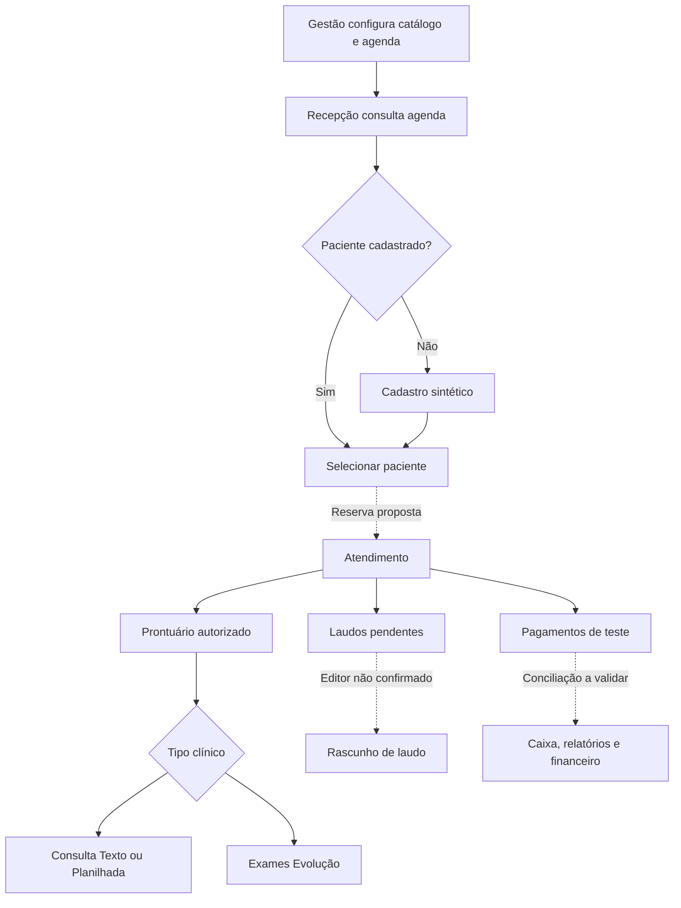

# DEV-006 — Jornadas completas de UX, navegação e wireflows

**Projeto Piloto • 05/11/2026 • versão de trabalho 0.2 • Tarefa #4 — EM ANDAMENTO**

> **Escopo aprovado:** critérios DEV-005 v1.0. Este mapa descreve uma **implementação original**; as jornadas propostas são requisitos de design, não provas de como o WebUltra grava ou integra informações. Não há site funcional nem validação assistencial nesta etapa.

## 1. Objetivo e fontes

Descrever, para a fase **UX e arquitetura**, cada jornada com ator, ponto de entrada, decisão, próximo passo, resultado final, exceções, telas ADM/MED e estado de evidência. O documento alimenta a **DEV-007 (protótipo visual Figma)** e o modelo de dados DEV-009, sem inventar comportamentos no sistema original.

- [DEV-005 aprovada — critérios de paridade](DEV-005_CRITERIOS_PARIDADE.md)
- [DEV-005 — critérios detalhados das 65 telas](DEV-005_CRITERIOS_POR_TELA.json)
- [DEV-004 — mapa e dependências](DEV-004_MAPA_FUNCIONAL.md)
- [DEV-002 — relação visual corrigida](DEV-002_MATRIZ_VISUAL.md)
- [Manual administrativo no Drive](https://drive.google.com/file/d/1BxsC35dauQ7ByHGgG7NtBaBj6GDxIgJG/view) e [manual médico](https://drive.google.com/file/d/1Kco9DwEOoLhtS5I9vzuonn_GSGcAgrO6/view)

**Legenda:** **O = observado** (controle ou tela visível); **D = documentado** (fluxo narrado no manual, ainda não repetido); **P = proposto** (requisito original do Projeto Piloto, ainda não validado como comportamento do WebUltra). Nenhum fluxo foi marcado como funcionalmente testado.

**Revisão de fontes:** [confronto documental dos manuais administrativo e médico, lacunas e decisões pendentes](DEV-006_REVISAO_FONTES.md). Os 53 passos possuem indicação explícita de **ação não testada**, mesmo quando o controle foi observado na tela.

## 2. Navegação e papéis propostos

### Estrutura de menu (sem copiar o layout ou a marca do fornecedor)

```text
Projeto Piloto
├── Área de recepção
│   ├── Agenda (/agenda)
│   ├── Pacientes (/pacientes)
│   └── Atendimentos (/atendimentos)
├── Área médica
│   ├── Meus atendimentos (/medico/atendimentos)
│   ├── Prontuário (/prontuarios/:id)
│   │   ├── Dados e histórico
│   │   ├── Consulta Texto / Consulta Planilhada
│   │   ├── Exames Evolução
│   │   ├── Receituário
│   │   └── Impressão e anexos
│   └── Laudos pendentes (/laudos/pendentes)
├── Área de gestão
│   ├── Agendas e cotas
│   ├── Profissionais, procedimentos e grupos
│   ├── Convênios e preços
│   ├── Relatórios
│   └── Financeiro
└── Administração
    ├── Usuários e perfis
    ├── Modelos e consentimentos
    └── Configurações
```

**Esses caminhos são nomes de rotas propostos para o novo projeto**, não URLs confirmadas do WebUltra. Cada página somente deve ser exibida a pessoas com autorização de servidor; esconder o item do menu não é mecanismo de segurança.

| Papel | Entrada inicial proposta | Objetivo | Regra essencial |
|---|---|---|---|
| Recepção | /agenda | Selecionar horário, localizar paciente e registrar atendimento | Sem assinar laudo ou prescrever |
| Médico | /medico/atendimentos | Abrir atendimento autorizado, prontuário, evolução e rascunho de laudo | Restringir acesso ao paciente e à unidade vinculados |
| Gestão | /gestao/visao-geral | Cadastros de apoio, valores, caixa e relatórios | Gestão não herda assinatura médica |
| Administrador técnico | /administracao/usuarios | Gerenciar contas e permissões | Acesso aos dados clínicos não é irrestrito |

## 3. Visão geral das jornadas

| Código | Jornada | Ator | Início | Fim | Prioridade proposta |
|---|---|---|---|---|---|
| UX-01 | Preparação administrativa para atendimento | gestao, administrador | Gestor autenticado abre Cadastros / Configuração | Catálogo, profissionais, convênios, preços e agenda de homologação prontos para a recepção | MVP |
| UX-02 | Recepção — busca, cadastro e agendamento | recepcao, gestao | Recepcionista abre a agenda por dia/profissional | Horário de teste registrado ou indisponibilidade explicada claramente | MVP |
| UX-03 | Recepção — registro de atendimento e pagamento | recepcao, gestao | Recepcionista abre Novo atendimento, diretamente ou por referência a uma agenda | Atendimento fictício salvo e visível na listagem, com totais coerentes | MVP |
| UX-04 | Médico — prontuário e evolução de consulta | medico | Médico autenticado abre sua lista de atendimentos autorizados | Rascunho de evolução clínica sintética preservado com autoria e histórico | MVP |
| UX-05 | Médico — evolução obstétrica e ginecológica | medico | Médico acessa Exames Evolução dentro de um prontuário de teste | Medidas sintéticas armazenadas sem cálculo clínico não homologado | V1 |
| UX-06 | Médico — laudos pendentes até rascunho | medico | Médico autenticado entra em Atendimentos > Laudos Pendentes | Rascunho de laudo de exame fictício criado e retornado à fila; publicação real bloqueada | MVP |
| UX-07 | Gestão — conciliação financeira, caixa e faturamento | gestao | Gestor abre procedimentos/preços ou consulta atendimentos de um período fictício | Relatórios e painel reconciliados por critérios documentados, sem emissão fiscal real | V1 |

## 4. Fluxo de navegação entre domínios



**Linhas pontilhadas** representam vínculos que não foram funcionalmente confirmados nos levantamentos. O fluxo não significa que um módulo atualize automaticamente outro.

## 5. Especificação passo a passo de cada jornada

### UX-01 — Preparação administrativa para atendimento

**Ator(es):** gestao, administrador. **Fase:** MVP. **Início:** Gestor autenticado abre Cadastros / Configuração. **Fim:** Catálogo, profissionais, convênios, preços e agenda de homologação prontos para a recepção. **Estado terminal pretendido:** `configuracao_pronta_no_sandbox`.

**Referências:** `ADM-17`, `ADM-18`, `ADM-19`, `ADM-20`, `ADM-21`, `ADM-22`, `ADM-23`, `ADM-25`, `ADM-38`, `ADM-02`, `ADM-05`. **Entidades candidatas:** `medico`, `grupo_procedimento`, `procedimento`, `convenio`, `preco_por_vigencia`, `agenda`, `local`, `perfil`.

| Etapa | Tela(s) | Ação/interface | Evidência | Resultado | Falha/tratamento |
|---|---|---|---|---|---|
| A1 | ADM-25 | Gestor visualiza o perfil aplicável e acessa cadastros autorizados | **O** | Sessão com ações permitidas | Acesso negado quando fora da política; não elevar privilégios. |
| A2 | ADM-17, ADM-18 | Localiza ou cadastra médico sintético com conselho e especialidade | **O** | Profissional disponível como opção | CRM/UF inválidos; certificado real não solicitado no sandbox. |
| A3 | ADM-20, ADM-19, ADM-38 | Cria grupo e procedimento de teste; informa códigos/tipo e termo | **D** | Procedimento consistente com grupo | Nome repetido, código inválido e consentimento ausente. |
| A4 | ADM-22, ADM-23 | Cria convênio fictício e configura regras propostas | **D** | Convênio ativo na lista | Coparticipação depende de regra ainda não validada. |
| A5 | ADM-21 | Define preço com data de vigência para procedimento e convênio | **O** | Preço pronto para seleção no atendimento | Preço inexistente / datas conflitantes: exigir confirmação, não inventar valor. |
| A6 | ADM-02, ADM-05 | Define agenda e local de atendimento fictícios | **D** | Agenda consultável na recepção | Conflito, local não cadastrado e horário indisponível. |
| A7 | ADM-01 | Confere agenda vazia ou horários de teste conforme filtros | **O** | Configuração verificada visualmente | Se listagem vazia, exibir estado vazio em vez de falha de sistema. |

**Caminhos alternativos / exceções:**
- Cadastro incompleto: manter rascunho, mostrar qual relação está ausente.
- Sem permissão: exibir 403 e registrar tentativa sem dados clínicos.
- Preço não disponível: permitir configuração na gestão e evitar cobrança automática fictícia.

**Dependências e regras de controle:**
- Não enviar PFX, senhas ou assinatura real.
- Profissional inativo não pode receber novos agendamentos sem política aprovada.
- Convênio, procedimento e preço precisam de relacionamento consistente.

**Não presumir do sistema de origem:**
- Fluxo de configuração sequencial é PROPOSTO; o sistema observado não comprova dependências obrigatórias entre cadastros.
- Matriz de permissões não foi testada.

### UX-02 — Recepção — busca, cadastro e agendamento

**Ator(es):** recepcao, gestao. **Fase:** MVP. **Início:** Recepcionista abre a agenda por dia/profissional. **Fim:** Horário de teste registrado ou indisponibilidade explicada claramente. **Estado terminal pretendido:** `agendamento_confirmado_no_sandbox_ou_nao_disponivel`.

**Referências:** `ADM-01`, `ADM-02`, `ADM-03`, `ADM-04`, `ADM-05`, `ADM-06`, `ADM-15`, `ADM-16`, `MED-21`. **Entidades candidatas:** `agenda`, `slot`, `agendamento`, `paciente`, `convenio`, `cota`, `feriado`, `excecao`.

| Etapa | Tela(s) | Ação/interface | Evidência | Resultado | Falha/tratamento |
|---|---|---|---|---|---|
| B1 | ADM-01 | Seleciona agenda e data; visualiza horários e status | **O** | Grade de horários | Nenhuma agenda configurada, erro de filtro e sem acesso. |
| B2 | ADM-03, ADM-04, ADM-06 | Sistema de homologação aplica, conforme política proposta, exceção, feriado e cota | **P** | Horários elegíveis destacados | Cota esgotada ou feriado bloqueia seleção após regra aprovada. |
| B3 | ADM-15 | Recepcionista procura paciente fictício por nome | **O** | Paciente existente ou resultado vazio | Exibir opção 'Novo paciente' quando não encontrado. |
| B4 | ADM-16 | Se necessário, preenche cadastro com campos e validações | **O** | Paciente fictício cadastrado | CPF de teste inválido, duplicidade, campos vazios. |
| B5 | ADM-01, ADM-05 | Escolhe horário, paciente, convênio e procedimento na proposta de reserva | **P** | Resumo para confirmação | Agenda ou médico indisponível, cota excedida, convênio inativo. |
| B6 | ADM-01 | Confirma reserva sintética com verificação de concorrência no servidor | **P** | Horário confirmado e identificador de teste | Duas pessoas tentam mesmo horário: apenas uma reserva aceita. |
| B7 | ADM-01 | Retorna à grade e confere horário/status; pode consultar detalhes | **P** | Fluxo termina com grade atualizada | Operação falhou: manter dados e permitir nova tentativa segura. |

**Caminhos alternativos / exceções:**
- Paciente já existe: não abrir cadastro novamente.
- Horário indisponível: voltar à grade sem criar atendimento.
- Cancelamento antes da confirmação: nenhuma gravação.
- Conexão perdida: consultar estado antes de repetir envio.

**Dependências e regras de controle:**
- Não permitir reserva dupla
- Não revelar dados de pacientes a perfis não autorizados
- Fluxo mobile em uma coluna com horário legível

**Não presumir do sistema de origem:**
- O botão/fluxo de efetivar uma reserva não foi demonstrado nos manuais; seu desenho é PROPOSTO para o Projeto Piloto.
- Como feriados, cotas e exceções afetam disponibilidade ainda não foi testado.

### UX-03 — Recepção — registro de atendimento e pagamento

**Ator(es):** recepcao, gestao. **Fase:** MVP. **Início:** Recepcionista abre Novo atendimento, diretamente ou por referência a uma agenda. **Fim:** Atendimento fictício salvo e visível na listagem, com totais coerentes. **Estado terminal pretendido:** `atendimento_sintetico_salvo`.

**Referências:** `ADM-13`, `ADM-14`, `ADM-15`, `ADM-16`, `ADM-19`, `ADM-21`, `ADM-22`, `ADM-26`, `ADM-27`. **Entidades candidatas:** `paciente`, `atendimento`, `item_atendimento`, `preco_por_vigencia`, `forma_pagamento`, `pagamento`, `status`.

| Etapa | Tela(s) | Ação/interface | Evidência | Resultado | Falha/tratamento |
|---|---|---|---|---|---|
| C1 | ADM-13, ADM-14 | Abre formulário Novo atendimento | **O** | Formulário vazio ou pré-selecionado | Falta de permissão ou agendamento removido. |
| C2 | ADM-15, ADM-16 | Seleciona paciente existente ou cadastra paciente fictício | **O** | Vínculo com prontuário sintético | Paciente não existe; duplicidade de cadastro. |
| C3 | ADM-14, ADM-22 | Seleciona convênio, data, autorização e médico solicitante quando aplicável | **O** | Cabeçalho do atendimento preenchido | Convênio inativo, guia incompleta ou data inválida. |
| C4 | ADM-19, ADM-21, ADM-14 | Adiciona procedimento e médico, incidência e indicação clínica | **O** | Tabela de itens calculada para revisão | Procedimento ausente ou preço inválido; apresentar aviso. |
| C5 | ADM-21, ADM-14 | Revisa valor de tabela e valor cobrado, registrando origem/ajuste | **P** | Totais sem arredondamentos ocultos | Não presumir mesmo valor para pago, cobrado e faturado. |
| C6 | ADM-26, ADM-27, ADM-14 | Se houver pagamento, escolhe forma e informa valor de teste | **O** | Pagamento ligado ao atendimento | Pagamento parcial e saldo aberto devem permanecer distintos. |
| C7 | ADM-14 | Confere dados, informações e conclui Salvar em sandbox | **D** | Registro de atendimento com identificador auditável | Falha de validação mantém dados no formulário sem duplicar. |
| C8 | ADM-13 | Consulta listagem por data/status e confere dados do registro | **O** | Atendimento encontrado na grade | Falta de permissão deve bloquear detalhes/edição. |

**Caminhos alternativos / exceções:**
- Atendimento sem agendamento prévio: fluxo permitido somente se regra aprovada.
- Preço por convênio inexistente: exigir correção ou autorização explícita.
- Pagamento 0/parcial: não tratar como liquidado.
- Solicitação de NFSe: apenas sinalização em sandbox, sem emissão real.

**Dependências e regras de controle:**
- Transação coerente entre itens e atendimento
- Idempotência para duplo clique em salvar
- Diferenciar valor_tabela, valor_cobrado e valor_pago

**Não presumir do sistema de origem:**
- Vínculo automático agendamento→atendimento não foi comprovado; origem direta e por agenda são caminhos propostos.
- Autopreenchimento do preço é pendência histórica; não implementar como regra comprovada.

### UX-04 — Médico — prontuário e evolução de consulta

**Ator(es):** medico. **Fase:** MVP. **Início:** Médico autenticado abre sua lista de atendimentos autorizados. **Fim:** Rascunho de evolução clínica sintética preservado com autoria e histórico. **Estado terminal pretendido:** `evolucao_rascunho_salva`.

**Referências:** `MED-01`, `MED-02`, `MED-14`, `MED-15`, `MED-16`, `MED-17`, `MED-18`, `ADM-13`. **Entidades candidatas:** `atendimento`, `paciente`, `prontuario`, `evolucao_texto`, `evolucao_estruturada`, `anexo`, `auditoria`.

| Etapa | Tela(s) | Ação/interface | Evidência | Resultado | Falha/tratamento |
|---|---|---|---|---|---|
| D1 | MED-01 | Filtra atendimentos por período e encontra registro autorizado | **O** | Linha selecionada | Nenhuma consulta; tentativa de acessar outra unidade. |
| D2 | MED-01, MED-02 | Aciona Abrir Prontuário Paciente e revisa Dados e Histórico | **D** | Contexto clínico e triagem visíveis conforme permissão | Acesso sem consentimento/permissão indevido é negado. |
| D3 | MED-02 | Revisa anotação de triagem, sinais e histórico com campos disponíveis | **O** | Contexto clínico do atendimento | Dados ausentes exibidos como não informados, sem valor padrão fictício. |
| D4 | MED-14, MED-15 | Escolhe entre Consulta Texto e Consulta Planilhada | **O** | Editor específico ativo | Alternar sem salvar deve alertar sobre alterações. |
| D5 | MED-14, MED-15 | Preenche evolução fictícia e valida campos/conteúdo | **O** | Rascunho coerente com tipo escolhido | Campos obrigatórios e texto vazio sinalizados. |
| D6 | MED-14, MED-15 | Salva rascunho em ambiente de homologação com autoria e versão | **P** | Versão gravada com timestamp e autor | Concorrência na edição: não sobrescrever silenciosamente. |
| D7 | MED-16, MED-18 | Acessa receituário/atestado apenas em pré-visualização de teste | **O** | Documento fictício sem validade clínica | Não gerar assinatura médica real sem autorização. |
| D8 | MED-02 | Retorna ao prontuário e confirma histórico da consulta fictícia | **P** | Registro localizável e auditável | Falha ao sincronizar: apresentar erro e opção segura de nova tentativa. |

**Caminhos alternativos / exceções:**
- Consulta cancelada: abandonar rascunho sem publicação.
- Consulta Texto vs. Planilhada: dados preservados em tipos distintos.
- Paciente sem histórico: estado inicial vazio; nunca preencher diagnóstico automático.
- Tentativa de consulta por profissional sem vínculo: 403 e trilha de acesso.

**Dependências e regras de controle:**
- Histórico clínico versionado e autor identificado
- Autorização server-side por prontuário
- Nenhum documento de teste aparenta ser prescrição válida

**Não presumir do sistema de origem:**
- Consulta Texto e Consulta Planilhada são telas distintas observadas, mas como se integram à linha do tempo do prontuário não foi testado.
- Geração de receitas, PDFs e assinatura deve permanecer bloqueada ou simulada até homologação.

### UX-05 — Médico — evolução obstétrica e ginecológica

**Ator(es):** medico. **Fase:** V1. **Início:** Médico acessa Exames Evolução dentro de um prontuário de teste. **Fim:** Medidas sintéticas armazenadas sem cálculo clínico não homologado. **Estado terminal pretendido:** `evolucao_exame_sintetica_em_rascunho`.

**Referências:** `MED-03`, `MED-04`, `MED-05`, `MED-06`, `MED-07`, `MED-08`, `MED-09`, `MED-10`, `MED-11`, `MED-12`, `MED-13`. **Entidades candidatas:** `evolucao_exame`, `medida_obstetrica`, `medida_ginecologica`, `serie_temporal`, `unidade_medida`.

| Etapa | Tela(s) | Ação/interface | Evidência | Resultado | Falha/tratamento |
|---|---|---|---|---|---|
| E1 | MED-03 | Entra em Exames Evolução e consulta histórico de tipos/data | **O** | Lista de evoluções | Sem registros exibir vazio com ação de teste. |
| E2 | MED-03, MED-04, MED-08 | Escolhe Dados Obstétricos ou Dados Ginecológicos | **O** | Formulário com abas específicas | Tipo indefinido impede persistência. |
| E3 | MED-04, MED-05, MED-06, MED-07 | Para obstétrico, navega Dados, Biometria, 1º Trimestre e Doppler | **O** | Campos correspondentes ao tipo | Fórmulas de IG, DPP e percentis bloqueadas enquanto não validadas. |
| E4 | MED-08, MED-09, MED-10, MED-11, MED-12 | Para ginecológico, navega Dados, Medidas, Miomas, Massas e Folículos | **O** | Campos e listas de múltiplos achados | Unidades/dimensões inconsistentes produzem mensagem clara. |
| E5 | MED-03 | Cancela ou grava somente rascunho de teste com vínculo ao prontuário | **P** | Registro de evolução fictícia disponível | Cancelar não pode persistir alterações. |
| E6 | MED-13 | Abre gráfico de variável para dados sintéticos, com alerta de demonstração | **O** | Gráfico reproduz dados registrados | Ausência de medida ou unidade válida exibe aviso, sem percentual inventado. |
| E7 | MED-03 | Retorna à grade e verifica data/tipo e autoria da evolução | **P** | Fluxo encerrado com rastreabilidade | Medida de outro paciente nunca compõe série. |

**Caminhos alternativos / exceções:**
- Somente ginecologia: não exibir campos obstétricos por engano.
- Sem dado suficiente para gráfico: estado vazio, não curva interpolada não explicada.
- Fórmula médica pendente: valores manuais com aviso de não validação.

**Dependências e regras de controle:**
- Não calcular/mostrar indicadores clínicos sem referência aprovada
- Segregar por paciente e tipo de medida
- Valores de unidade explícitos e persistência em rascunho

**Não presumir do sistema de origem:**
- Os campos das abas foram observados, porém regras de cálculo e unidades não foram clinicamente validadas.
- A aba Doppler não possui captura própria. Os gráficos devem operar em modo demonstrativo até validados.

### UX-06 — Médico — laudos pendentes até rascunho

**Ator(es):** medico. **Fase:** MVP. **Início:** Médico autenticado entra em Atendimentos > Laudos Pendentes. **Fim:** Rascunho de laudo de exame fictício criado e retornado à fila; publicação real bloqueada. **Estado terminal pretendido:** `laudo_em_rascunho_nao_publicado`.

**Referências:** `MED-20`, `MED-01`, `ADM-28`, `ADM-29`, `ADM-30`, `ADM-37`, `MED-25`. **Entidades candidatas:** `exame`, `atendimento`, `laudo`, `modelo_laudo`, `versao_laudo`, `assinatura`, `auditoria`.

| Etapa | Tela(s) | Ação/interface | Evidência | Resultado | Falha/tratamento |
|---|---|---|---|---|---|
| F1 | MED-20 | Seleciona período e médico autorizados e atualiza fila | **O** | Lista de laudos pendentes com exame e paciente | Fila vazia sem expor dados de outras pessoas. |
| F2 | MED-20 | Seleciona exame fictício autorizado | **D** | Detalhes mínimos e ação para editar rascunho | Exame inexistente, concluído ou sem permissão. |
| F3 | ADM-29, ADM-28 | Seleciona modelo aprovado de demonstração e frase padrão | **P** | Editor original do Projeto Piloto preenchido com texto de teste | Modelo ausente: editor vazio com aviso; proibir inserção de dados não autorizados. |
| F4 | MED-20 | Redige laudo fictício e faz prévia sem assinatura | **P** | Texto e título revisáveis | HTML do editor sanitizado; evitar execução de script. |
| F5 | MED-20 | Salva versão do rascunho com autoria e horário | **P** | Rascunho vinculado ao exame | Conflito de edição e travamento de versão expostos ao usuário. |
| F6 | ADM-37, MED-25 | Pré-visualiza cabeçalho próprio e campos de impressão no sandbox | **P** | Prévia identificada como DOCUMENTO DE TESTE | Falha no modelo: salvar rascunho sem criar PDF inválido. |
| F7 | MED-20 | Solicita revisão opcional; assinatura/publicação permanecem indisponíveis no MVP | **P** | Rascunho ou revisão pendente; não publicado | Botões reais bloqueados até segurança, certificado e homologação. |
| F8 | MED-20 | Retorna à fila e confirma estado atual do laudo | **P** | Fim com status persistido e auditável | Não alterar status sem registro do evento. |

**Caminhos alternativos / exceções:**
- Nenhum laudo pendente: orientação sem botão enganoso.
- Modelo de laudo não cadastrado: iniciar rascunho limpo.
- Assinatura não configurada: operação não habilitada e explicação do motivo.
- Troca de médico: exigir autorização; não compartilhar texto entre perfis.

**Dependências e regras de controle:**
- Proibir publicação/assinatura em homologação até homologação específica
- Versionamento de texto e autoria
- Validação do editor de laudos ainda pendente de captura real

**Não presumir do sistema de origem:**
- Filtro e atalho de laudo pendente foram observados; editor específico e publicação NÃO foram inspecionados.
- O fluxo rascunho→revisão→assinado→publicado é PROPOSTO, sujeito à autorização e validação.

### UX-07 — Gestão — conciliação financeira, caixa e faturamento

**Ator(es):** gestao. **Fase:** V1. **Início:** Gestor abre procedimentos/preços ou consulta atendimentos de um período fictício. **Fim:** Relatórios e painel reconciliados por critérios documentados, sem emissão fiscal real. **Estado terminal pretendido:** `reconciliacao_sintetica_conferida`.

**Referências:** `ADM-14`, `ADM-13`, `ADM-21`, `ADM-22`, `ADM-26`, `ADM-27`, `ADM-07`, `ADM-08`, `ADM-09`, `ADM-10`, `ADM-11`, `ADM-12`, `ADM-32`, `ADM-33`, `ADM-34`, `ADM-35`. **Entidades candidatas:** `preco_por_vigencia`, `atendimento`, `item_atendimento`, `pagamento`, `categoria_financeira`, `lancamento_financeiro`, `relatorio`.

| Etapa | Tela(s) | Ação/interface | Evidência | Resultado | Falha/tratamento |
|---|---|---|---|---|---|
| G1 | ADM-21 | Confere valores de referência por convênio, procedimento e data | **O** | Tabela de preço da homologação definida | Sem preço aplicável exibir origem e solicitar decisão de gestão. |
| G2 | ADM-13, ADM-14 | Filtra atendimentos e revisa valor de tabela, cobrado e pago | **O** | Base analítica segregada por evento | Estorno, desconto e pagamento parcial devem ser explicitados. |
| G3 | ADM-26, ADM-27 | Consulta forma de pagamento e flag NFSe sem transmitir nota real | **O** | Regra de interface de teste aplicada | Não emitir nota real, mesmo com flag ligada. |
| G4 | ADM-10, ADM-11 | Filtra caixa por período e profissional onde permitido | **O** | Total de pagamentos recebidos de teste | Duplicidade e pagamento de competência distinta exigem regra explícita. |
| G5 | ADM-09, ADM-07, ADM-08 | Abre relatórios de faturamento e analítico com filtros documentados | **O** | Resultado por convênio e período | Não misturar receita, pagamento e valor cobrado. |
| G6 | ADM-32, ADM-33, ADM-34, ADM-35 | Consulta grupos e financeiro mensal, com previsão/pago destacados | **O** | Visão sintética de lançamentos | Geração automática de receita e recorrência NÃO presumida. |
| G7 | ADM-35 | Executa checagens de conciliação propostas sobre dataset fictício conhecido | **P** | Diferenças apresentadas com origem e datas | Inconsistência não desaparece silenciosamente. |
| G8 | ADM-35 | Exporta demonstrativo de homologação com legenda de critérios | **P** | Fluxo termina com evidência de valores e status | Nunca enviar dados reais nem transmitir NFSe. |

**Caminhos alternativos / exceções:**
- Pagamento parcial: saldo aberto e previsão independentes.
- Estorno de teste: não apagar histórico, registrar reversão.
- Lançamento manual: marcar origem para não duplicar pagamento convertido em receita.
- Sem dados no período: totais zero e mensagem clara, não erro.

**Dependências e regras de controle:**
- Reconciliar quantidades e totais com dataset sintético
- Proibir emissão NFSe real
- Separar data de atendimento, pagamento e lançamento

**Não presumir do sistema de origem:**
- O WebUltra mostra colunas de valor tabela/cobrado/pago e relatórios separados; não foi validado se pagamentos criam automaticamente entradas no financeiro.
- NFSe e despesas recorrentes não foram exercitados; automatismos ficam pendentes.

## 6. Estados de interface e transições para os wireflows

### Estados globais para todas as páginas

| Estado | Interface esperada no Projeto Piloto | Critério de UX |
|---|---|---|
| Carregando | Indicador no conteúdo, não encobrir navegação | Desabilitar duplo envio e preservar foco |
| Lista vazia | Mensagem contextual com ação segura | Não simular dado inexistente |
| Formulário inválido | Erro ao lado de campo + resumo acessível | Não perder entrada digitada |
| Sem permissão | Acesso negado com retorno | Proibir requisição no backend e não exibir informação pessoal |
| Erro no servidor | Aviso legível e tentativa segura | Evitar requisição duplicada/cobrança dupla |
| Alterações não salvas | Confirmação antes de sair ou trocar aba | Cancelar sai sem gravar |
| Salvamento confirmado | Retorno com ID e ações autorizadas | Nova consulta identifica versão gravada |
| Item excluído/cancelado | Motivo e trilha de auditoria conforme regra | Não excluir definitivamente prontuário sem política de retenção |

### Máquina de estados proposta por domínio

| Domínio | Estados de homologação | Transição importante | Bloqueio |
|---|---|---|---|
| Agendamento | disponível → selecionado → confirmado / cancelado | Confirmar com checagem de conflito | Reserva dupla e cota/feriado segundo regra aprovada |
| Atendimento | novo → rascunho → registrado → em andamento → concluído | Salvar itens e paciente como unidade de trabalho | Não salvar duplicado em repetição de clique |
| Consulta | aberta → rascunho → gravada → adendo / retificação | Registrar versões, não sobrescrever conteúdo clínico sem trilha | Profissional sem vínculo |
| Laudo | pendente → rascunho → em revisão → assinado → publicado | **No MVP só até rascunho**; demais após homologação | Sem assinatura/certificado autorizado |
| Caixa | valor previsto → cobrado → parcialmente pago / pago → estornado | Conciliar múltiplos pagamentos com histórico | Jamais igualar cobrado a recebido automaticamente |

## 7. Wireframe de referência para a DEV-007

### Composição desktop (alvo 1440 × 900 / 1366 × 768)

```text
┌───────────────────┬────────────────────────────────────────────────┐
│ Projeto Piloto    │ [Contexto/unidade]       [Usuário] [Sair]    │
│ Menu do perfil   ├────────────────────────────────────────────────┤
│                  │ Título + trilha de navegação                  │
│ > Agenda         │ Filtros e ações principais                     │
│ > Pacientes      │ ┌────────────────────────────────────────────┐ │
│ > Atendimentos   │ │ Tabela / formulário / editor / gráfico    │ │
│ > Prontuário *   │ │ Estados vazio/carregando/erro             │ │
│ > Laudos *       │ └────────────────────────────────────────────┘ │
│ > Financeiro *   │ Rodapé com ações e estado                      │
└───────────────────┴────────────────────────────────────────────────┘
 * Somente quando autorizado no papel/unidade
```

### Composição mobile (alvo 375 × 812 / 390 × 844)

```text
┌─────────────────────────┐
│ ☰ Projeto Piloto   Usu. │
├─────────────────────────┤
│ Trilha / Voltar         │
│ Título                  │
│ [Filtro principal]      │
│ [Mais filtros ▼]        │
│ [Ação principal]        │
│ ┌─────────────────────┐ │
│ │ Lista / tabela      │ │
│ │ com rolagem interna │ │
│ │ ou cards adaptados  │ │
│ └─────────────────────┘ │
│ [Ajuda ou estado]       │
└─────────────────────────┘
```

**Componentes originais propostos** (implementação posterior): `AppShell`, `SidebarNav`, `Topbar`, `Breadcrumbs`, `FilterBar`, `DataTable`, `FormSection`, `FieldError`, `PatientSearch`, `AppointmentSlot`, `EncounterItems`, `MedicalNoteEditor`, `ClinicalTabs`, `PendingReportsList`, `FinanceSummary`, `EmptyState`, `AccessDenied`, `ConfirmDialog`, `AuditTimeline`.

### Orientações de handoff

- O Figma da DEV-007 deverá incluir, no mínimo, **agenda, busca/cadastro de paciente, novo atendimento, prontuário, consulta texto/planilhada, laudos pendentes e financeiro**, em desktop e mobile.
- Criar variante visual para **estado vazio, formulário inválido, loading, acesso negado, confirmação e sucesso** em cada template relevante.
- Campos de obstetrícia/ginecologia e calculadoras exigem **componentes com alerta de demonstração**, sem simular precisão clínica.
- Não anexar capturas reais ou documentos identificáveis ao GitHub público; eventual comparação visual fica em ambiente restrito e sob autorização.

## 8. Critérios de aceite da DEV-006 e testes futuros

| ID | Verificação objetiva | Evidência esperada |
|---|---|---|
| UX-QA-01 | 7 jornadas têm início, fim, ator e estado terminal | JSON validado |
| UX-QA-02 | Toda etapa referencia uma tela ADM/MED existente no inventário de 65 | Validador de IDs |
| UX-QA-03 | Cada etapa explicita resultado, evidência e tratamento de erro | Validador de estrutura |
| UX-QA-04 | Jornadas de recepção, médico, laudos e financeiro estão cobertas | Cobertura de domínios |
| UX-QA-05 | Fluxos reconhecem 5 tópicos sem captura e 10 nomes divergentes no material original | Referência à DEV-002 |
| UX-QA-06 | Cada jornada descreve exceções de vazio, permissão, cancelamento ou conflito conforme aplicável | Checklist por jornada |
| UX-QA-07 | Desktop 1440/1366 e mobile 375/390 têm wireframe de referência sem cópia de marca | Revisão documental |
| UX-QA-08 | Perfis e fluxos médicos/fiscais não alegam testes nem assinatura/nota reais | Revisão de risco |
| UX-QA-09 | Comparar menus, hierarquia, campos e estados com perfis administrativo e médico antes de fechar a tarefa | **Revisão conjunta ainda pendente** |

**Status da DEV-006:** documentação inicial pronta na branch; a revisão conjunta e a transferência para o Figma ainda são pendências. **Não finalizar DEV-006 apenas porque este Markdown existe.**

## 9. Entrega para a próxima etapa

- **DEV-006:** mapear os fluxos em `docs/DEV-006_JORNADAS.json` (estrutura pronta) e validar com os perfis de recepção e médico, incluindo erros e operações não observadas.
- **DEV-007:** transformar este documento em protótipos navegáveis originais de desktop/mobile; registrar evidência de cada tipo de tela e estado.
- **DEV-008:** estabelecer tokens visuais, cores, tipografia e componentes reutilizáveis.
- **DEV-009:** formalizar entidades, relações, permissões RLS e trilhas de auditoria após revisão dos fluxos.
