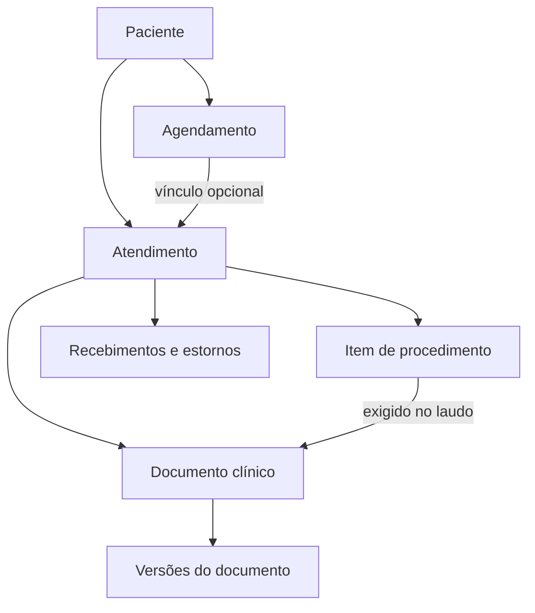

# DEV-009 — Modelo de dados do Projeto Piloto

O [modelo PostgreSQL](../database/dev009_modelo.sql) organiza 14 tabelas por unidade. É uma prova executável da arquitetura, com autenticação simulada e dados fictícios no [teste local](../database/dev009_modelo.test.cjs). A migração de implantação e o acesso da aplicação serão definidos nas etapas de infraestrutura e autorização.

## Entidades e vínculos

| Área | Entidades | Vínculos e regras |
|---|---|---|
| Unidade e acesso | `unidades`, `vinculos`, `profissionais` | Um usuário pode ter vários perfis por unidade. A matrícula profissional vincula a conta autenticada ao médico local. Perfil, unidade e profissional devem estar ativos para o acesso correspondente. |
| Cadastro | `pacientes`, `convenios`, `procedimentos`, `precos_procedimento` | Cadastro limitado à unidade. O código do procedimento é único na unidade. Vigências do mesmo procedimento e convênio não se sobrepõem. Particular é um convênio local de referência. |
| Recepção | `agendamentos`, `atendimentos`, `itens_atendimento` | O atendimento pode partir de um agendamento ou ser direto. O vínculo, quando existe, exige a mesma unidade, paciente e profissional. Um agendamento origina no máximo um atendimento. O item guarda quantidade e preço cobrado no momento do lançamento. |
| Prontuário | `documentos_clinicos`, `versoes_documento` | Evoluções narrativas, estruturadas e de exames ficam vinculadas ao atendimento. Laudo exige item do mesmo atendimento. Versões registram sequência, conteúdo, estado, data e ator. |
| Financeiro | `movimentos_financeiros`, visão `saldos_atendimento` | Cada entrada ou estorno tem chave de idempotência por unidade. O estorno integral referencia um único recebimento do mesmo atendimento e valor. Cobrado, recebido líquido e saldo são calculados separadamente. |
| Auditoria | `auditoria` | Cada mutação registra unidade, tipo de registro, ID, operação, ator e horário na mesma transação. O evento armazena metadados, sem copiar o conteúdo do prontuário. |



As chaves estrangeiras incluem `unidade_id` sempre que relacionam registros das unidades. A agenda usa intervalo de início inclusivo e fim exclusivo. Horários adjacentes são permitidos. A restrição de sobreposição ignora cancelamentos. Abrir um atendimento preserva o horário reservado.

## Acesso por linha

A política usa a identidade autenticada e os vínculos atuais do banco. Um usuário acumula apenas as permissões dos perfis ativos que possui em cada unidade. Os schemas `piloto` e `piloto_privado` devem ficar fora da lista de exposição da Data API. O SQL concede leitura com RLS para o papel `authenticated` no teste. A identidade interna que liga profissional e conta fica fora das colunas concedidas. Alterações da aplicação serão definidas na API, com autorização e transações próprias.

| Perfil ativo | Leitura prevista no modelo |
|---|---|
| Recepção | Agenda, cadastros, catálogo, preços e atendimentos da unidade, inclusive itens cobrados |
| Médico | Própria agenda e atendimentos, pacientes vinculados, catálogo e documentos clínicos sob sua responsabilidade |
| Financeiro | Atendimentos, itens, tabelas de preço, movimentos e saldos da unidade |
| Gestão ou administrador | Cadastros operacionais de profissionais, agenda, catálogo, atendimentos e financeiro. A leitura clínica exige vínculo médico aplicável |
| Sem vínculo, vínculo inativo ou sessão anônima | Sem acesso às linhas da unidade |
| Auditoria e vínculos | Acesso do papel interno de manutenção. Os auxiliares da RLS consultam apenas o vínculo da identidade da sessão |

## Versões, movimentos e trilha

- A sequência de versões impede lacunas e duplicatas. A evolução começa em rascunho e pode ser finalizada. O laudo segue de rascunho para revisão, aprovação, assinatura referenciada e liberação. Devolução requer motivo. Durante revisão, assinatura e liberação, o conteúdo da versão precisa permanecer igual ao da anterior.
- O estorno de teste é integral por lançamento de recebimento. Recebimento parcial de uma cobrança funciona por lançamentos separados. Descontos, estorno parcial de um único recebimento, conciliação e política para saldo negativo ficam para os contratos e fluxos financeiros.
- A trilha desta etapa cobre gravações e registra o ator quando a sessão traz identidade autenticada. A DEV-015 tratará acesso de leitura, tentativas negadas e centralização. Segregação de revisão e assinatura de laudos, retenção e implantação serão definidas nas etapas correspondentes.

## Como reproduzir

Da raiz do repositório, com Node.js e npm. O teste instala a dependência em um diretório temporário e inicia PostgreSQL em memória por meio do PGlite. O teste simula as funções de autenticação do Supabase para verificar as políticas SQL.

```bash
piloto_teste_dir="$(mktemp -d)"
npm install --prefix "$piloto_teste_dir" --ignore-scripts --no-audit --no-fund --save-exact @electric-sql/pglite@0.5.15
NODE_PATH="$piloto_teste_dir/node_modules" node --test database/dev009_modelo.test.cjs
```

Foram exercitados cinco grupos de cenários. Eles cobrem vínculos entre unidades, conflito de agenda, versões e revisão de laudo, cobrança e estorno, acesso por perfil e auditoria. O teste usa apenas IDs, nomes e registros fictícios. O próximo passo é a DEV-010, definição de endpoints, filtros, paginação e contratos de API.

Referências técnicas. [Supabase RLS](https://supabase.com/docs/guides/database/postgres/row-level-security) · [Segurança da Data API](https://supabase.com/docs/guides/api/securing-your-api) · [Intervalos PostgreSQL](https://www.postgresql.org/docs/current/rangetypes.html)
